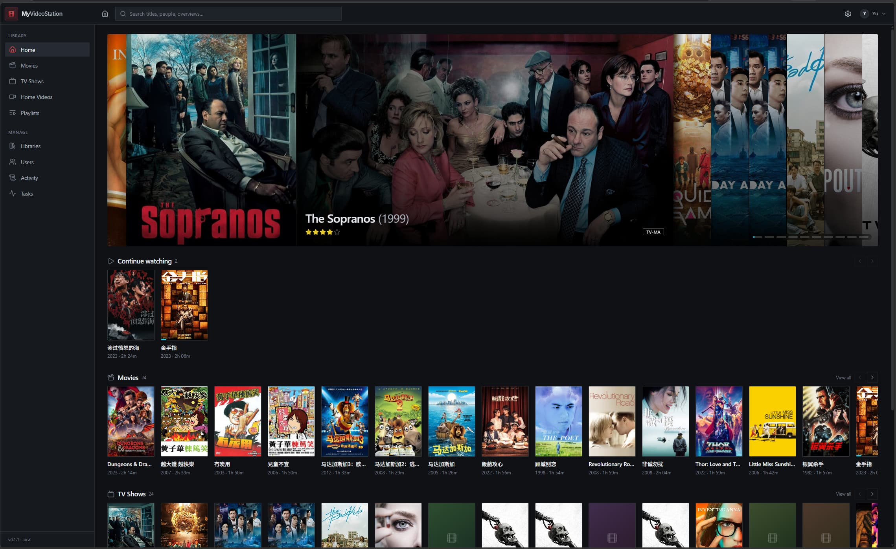

# MyVideoStation

**A modern, open-source re-creation of Synology Video Station.** One Go binary, SQLite,
and your existing folders — point it at a library and it identifies, organises, and plays
your movies and shows.

> **Status: M0–M4 plus M3.x monitoring and M6 account/access groundwork.** A single static binary with an
> embedded React UI indexes movie / TV / home-video libraries, probes with ffprobe, groups
> shows into seasons and episodes, browses and searches, edits metadata, direct-plays,
> and now has first-run admin setup, local user/admin accounts, per-user watch state,
> per-library permissions, rating ceilings, audit activity and an i18n scaffold.
> Transcoding (M5) and sharing links are still open.



---

## Why

Synology discontinued Video Station, and newer DSM builds gate HEVC/AAC behind a paid
codec extension tied to a Synology account. Meanwhile the self-hosted alternatives are
either heavy (a plugin platform plus a separate server stack) or stuck in a decade-old UI.

MyVideoStation aims for the opposite:

- **Media management first.** A correct scanner and filename parser, fast search, reliable
  metadata matching with manual override — before any streaming features.
- **Boring to operate.** One static binary, one SQLite file, one data volume, no Redis,
  no Node runtime, no external services except `ffmpeg`.
- **Non-destructive.** Never renames, moves, or deletes media. Sidecar data lives in `/data`.
- **Modern UI.** Dark-first, keyboard-friendly, responsive — inspired by Video Station's
  information architecture, not its 2013 ExtJS chrome.

## Quick start on Synology Docker

This is the supported deployment path: one Alpine image, a writable `/data` bind mount and
read-only media mounts. Run these commands over SSH as root (or with `sudo`).

### 1. Pull the image

```bash
docker pull ghcr.io/liyu1981/my-videostation:0.1.2
# or track the latest release:
# docker pull ghcr.io/liyu1981/my-videostation:latest
```

### 2. Decide the UID/GID

The image runs as the non-root `mvs` user by default: **UID 100 / GID 101**. On Synology it
is usually easier to run as a DSM user so shared-folder ACLs apply directly. Find its IDs
over SSH:

```bash
id myvideostation
# uid=1026(myvideostation) gid=100(users) groups=...
```

The example below uses `1026:100`; replace it with your user's real UID/GID. The user needs:

- **Read** access on the video shared folder(s);
- **Read/Write** access on the data folder.

```bash
sudo mkdir -p /volume1/docker/myvideostation
sudo chown -R 1026:100 /volume1/docker/myvideostation
```

If DSM ACLs override the ownership, also grant the same user **Read/Write** under
**Control Panel → Shared Folder → Permissions**. Keep the media mount read-only:
MyVideoStation never writes into your video folders.

### 3. Start the container

```bash
docker run -d \
  --name myvideostation \
  --restart unless-stopped \
  --user "1026:100" \
  -p 6500:6500 \
  -e MVS_LISTEN=0.0.0.0:6500 \
  -e MVS_DATA_DIR=/data \
  -v /volume1/docker/myvideostation:/data \
  -v /volume1/video:/media/video:ro \
  ghcr.io/liyu1981/my-videostation:0.1.2
```

- `/volume1/docker/myvideostation:/data` — SQLite DB, artwork cache, subtitle cache and
  logs. This is the only writable volume.
- `/volume1/video:/media/video:ro` — your media, mounted read-only. Add libraries using
  paths under `/media/video` (for example `/media/video/movies`).
- `6500:6500` — web UI. Open `http://<NAS-IP>:6500`.

The first visit opens the **admin setup** page; create the administrator account there.

> The image's default user is `100:101`. If you omit `--user`, chown `/data` to `100:101`
> (or use a named volume) and grant that user read access to media instead.

### 4. Allow Docker bridge traffic in the DSM firewall

Synology's firewall can drop Docker's forwarded traffic even though `docker pull` works.
Allow the Docker bridge subnet outbound:

1. **Control Panel → Security → Firewall → Edit Rules → Create**
2. **Source IP:** `172.17.0.0/16`
   (or the IP range `172.17.0.0`–`172.17.255.255` if your DSM build does not accept CIDR)
3. **Destination:** `All`
4. **Ports:** `All` — **Protocol:** `All` — **Action:** `Allow`
5. Move the rule **above any Deny rules**, then apply.

If you use a custom Docker network, use its subnet instead:

```bash
docker network inspect bridge --format '{{json .IPAM.Config}}'
```

Without this rule, the container may resolve DNS or reach TMDb only intermittently despite
the NAS itself having internet access. More DNS/proxy/MTU troubleshooting is in
[Docker: metadata requests time out](#docker-metadata-requests-time-out).

### 5. First library

After setup, go to **Manage → Libraries → Add library**, choose the type, then add a path
such as `/media/video/movies` using the folder picker or the text field. The initial scan is
queued automatically.

## Planned features

| Area | Capabilities |
|---|---|
| Libraries | Movies / TV Shows / Home Videos / TV Recordings, multiple paths per library, scheduled + optional live scanning |
| Metadata | TMDB provider (pluggable), poster/backdrop management, manual edit with per-field locks, "needs attention" queue, NFO sidecar support |
| Organisation | Poster grid, tile and list views, categories (recently added / watched / released, by folder, timeline), facets, global search, collections, favorites, watchlist |
| Playback | Direct play with range requests, subtitles (SRT/ASS/VTT), resume + watched state, then HLS remux/transcode with quality selection and optional hardware acceleration |
| People | Multi-user accounts, per-library permissions, parental controls, public share links |
| Ops | Durable job queue with progress, incremental scans, metrics/logs, backup/restore |

Known gaps versus the original (and where we deliberately diverge) are tracked
individually in [`docs/GAPS.md`](./docs/GAPS.md).

## Stack

| Layer | Choice |
|---|---|
| Backend | Go 1.27 · `net/http` · `modernc.org/sqlite` (CGO-free) · `sqlc` · `goose` · FTS5 |
| Media | `ffprobe` for metadata · `ffmpeg` for remux/transcode (HLS fMP4) |
| Frontend | React 19 · TypeScript 7 (`tsgo`) · Vite 8 · TanStack Router/Query/Table · Jotai · Tailwind CSS 4 |
| Packaging | Single static binary with embedded SPA · Alpine image (`amd64` + `arm64`) · Docker Compose |

## Architecture

```
┌──────────────────────────────────────────────────────────────┐
│  single static binary (CGO off)                              │
│  /api/v1/*   JSON REST        /            embedded SPA      │
│  /media/*    byte-range       /hls/*       transcoded output │
│                                                              │
│  services: library · scanner · metadata · playback · auth     │
│  jobs:     in-process workers + durable `jobs` table (SSE)    │
│  storage:  SQLite (WAL) + /data/cache for art and transcodes  │
└──────────────────────────────────────────────────────────────┘
      media dirs (read-only)               /data (read/write)
```

Planned layout:

```
cmd/mvs/            app entry point
internal/           config · db · store · media · naming · scanner · metadata
                    library · playback · auth · jobs · httpapi · web(embed)
migrations/         embedded goose SQL
sql/                sqlc query files
web/                React app (pnpm workspace)
deployments/        Dockerfile, docker-compose.yml
docs/               PLAN · GAPS · UI-PROBE · ADRs
testdata/           parser corpus and generated sample media
```

## What works today

| Area | Capabilities |
|---|---|
| Accounts & roles | First-run admin setup, login/logout, PBKDF2 passwords, HttpOnly sessions, admin/user roles, admin user management, self-service password change, per-user watch state and collections. |
| Access control | Per-library allow-lists and age/birth-year content-rating ceilings with optional stricter manual overrides, enforced server-side for libraries, browse, search, item, collection and media access. |
| Audit | Admin Activity log for auth, account, library, settings and metadata actions. |
| Localisation | English / German / Chinese UI scaffold with an account-menu language selector. |
| Libraries | Movie / TV / home-video libraries, multiple read-only paths, server-side folder picker, scheduled scans and an fsnotify watcher. |
| Scanning | Incremental size/mtime scans, durable jobs, four-worker probing, per-file failure isolation, `@eaDir`/`#recycle` skipping, extras/samples handling, placeholder indexing, and per-library scan rules (exclude/include globs, minimum file size, skip extras) that soft-hide excluded items. |
| Naming | Scene names, `SxxExx`, `1x02`, multi-episode ranges, CJK titles, editions and folder fallbacks. |
| Probing | ffprobe container, duration, resolution, codecs, HDR and audio/subtitle tracks; graceful fallback when ffprobe is absent. |
| Local metadata | Jellyfin/Kodi `.nfo` and Synology `.vsmeta`, with vsmeta winning field-by-field; local artwork; user/TMDb data survives rescans. |
| TMDb metadata | Search, match and refresh with confidence scoring, low-confidence flag, cast/crew/genres/certification, provider registry and language-aware queries. |
| Artwork | Cached posters/backdrops with Original / No images / URL / Upload choices, plus sidecar artwork discovery. |
| Browse | VS-style hero and ring shelf, continue watching, fixed 120 px poster grid, poster/tile/list views, categories, sorting, pagination, FTS5 search and show → season → episode navigation. |
| Item detail | VS poster/action layout, badges, metadata rows, paragraph-preserving summary, season bar and episode cards, prev/next arrows, extras and a media-info dialog. |
| Edit dialog | Video Info / Poster / Backdrop tabs, chip editors, per-field locks, nested TMDb search, best-effort fills, merge/keep prompts and “Select from existing”. |
| Subtitles | Sidecar and embedded WebVTT with charset detection (UTF-8/GB18030/Big5), ±60 s delay, cue size/colour and default-language preference; PGS/VobSub burned in by the transcoder. |
| Player | Direct play with resume/watched state, speed, fullscreen, keyboard shortcuts and browser-Back close. |
| Transcoding | On-demand HLS fMP4 sessions: remux-first, HEVC/VC-1/MPEG-2/AC3/DTS/TrueHD → H.264/AAC, audio-track switching, image-subtitle burn-in, quality cap, seek-by-restart, idle session cleanup and a global session cap. Software x264 by default with opt-in NVENC/QSV. |
| Continuous play | Next-up autoplay with countdown, same-season and cross-season rollover, and Play all/Shuffle episode queues with queue-aware previous/next. |
| Organisation | Favorites, watchlist and custom collections; selection mode with bulk watched/add-to-collection; genre/year/watched/folder facets. |
| Operations | Durable job queue with persisted per-file logs, per-library task cards, scan/rescan/enrich; in-app export/import bundles in `data/export` / `data/import` with maintenance restart; backup/restore docs and cache-path repair. |
| Casting | Best-effort Chromecast/AirPlay via browser remote playback and DLNA renderer discovery + SOAP playback. MP4/H.264/AAC only; unsupported formats report that transcoding is required. |
| Packaging | Single static Go binary with embedded SPA; Alpine Docker image for linux/amd64 and linux/arm64; Synology deployment guide. |

Casting caveats: open the app through the NAS LAN IP (not localhost), Chromecast remote playback/AirPlay need a secure browser context, and DLNA discovery uses SSDP multicast — Docker bridge networking may not receive it, so host networking may be needed for DLNA renderers.

**Not yet:** HLS remux/transcoding (M5), broad Chromecast/AirPlay format coverage (requires M5), PGS/VobSub/SMI subtitles, sharing links, OIDC/LDAP/SSO, 2FA and parental PIN.

## Getting started

```bash
pnpm install

# one-time (idempotent): installs air (Go live reload) + static ffprobe into .tools/
pnpm bootstrap

# dev: one server on :6500 — air rebuilds the SPA, embeds it and restarts the binary
pnpm dev

# production: web bundle -> embedded dist -> single static binary
pnpm build && ./bin/mvs --data ./data
```

Editing anything under `cmd/`, `internal/` or `web/src/` triggers a frontend build, a Go build
with the SPA embedded, and a restart — the same single server as production, on `:6500`
(reload the browser tab after a change; there is no separate Vite dev server or HMR).
Migrations are embedded too, so changing SQL also triggers a rebuild.

The dev server binds `0.0.0.0`, so you can open the UI from another device on the same LAN:
`http://<your-lan-ip>:6500`.

| Script | Purpose |
|---|---|
| `pnpm dev` | air watches Go + frontend, rebuilds the embedded single binary |
| `pnpm build` | embed the SPA and produce `bin/mvs` |
| `pnpm test` | Go test suite |
| `pnpm lint` | gofmt check, go vet, `tsc --noEmit` |
| `pnpm typecheck` | TypeScript only |
| `pnpm docker` | build the Alpine image with version metadata |
| `pnpm clean` | remove build artifacts (`pnpm clean -- --data` also drops the DB) |

Open <http://127.0.0.1:6500> (or :5173 in dev). The first visit opens the **admin setup**
page; after creating the admin account, go to **Libraries → Add library**, point it at a
folder, and it creates + starts a scan. Admins can add `user` or `admin` accounts under
**Manage → Users**; users can browse, play and keep their own watch state/collections.

Docker (media mounts are read-only by design):

```bash
MEDIA_MOVIES=/mnt/media/movies MEDIA_TV=/mnt/media/tv \
  docker compose -f deployments/docker-compose.yml up -d --build
```

### Docker on Synology: user and folder permissions

The image runs as the non-root `mvs` user: **UID 100 / GID 101**. On Synology it is
usually easier to run it as a DSM user, so DSM shared-folder ACLs apply directly:

```yaml
services:
  myvideostation:
    user: "1026:100"   # id -u <dsm-user> : id -g <dsm-user>
```

- The DSM user needs **Read** on the media shared folders; mount media with `:ro`.
- `/data` must be **writable** by that user:
  ```bash
  sudo mkdir -p /volume1/docker/myvideostation
  sudo chown -R 1026:100 /volume1/docker/myvideostation
  ```
  or grant **Read/Write** on the folder in **Control Panel → Shared Folder →
  Permissions**.
- If you override `user:` and use the named `mvs-data` volume, the volume starts owned by
  `100:101`; use a bind mount or `chown` the volume before starting.
- Keep media read-only; the app never needs to write there.

Verify:

```bash
docker exec myvideostation id
docker exec myvideostation test -w /data && echo data-writable
docker exec myvideostation ls /video
```

A complete Synology-style run:

```bash
docker run -d --name my-videostation \
  --restart unless-stopped \
  --user "1026:100" \
  -p 65000:6500 \
  -v /volume1/docker/myvideostation:/data \
  -v /volume1/video:/video:ro \
  ghcr.io/liyu1981/my-videostation:latest
```

### Docker: metadata requests time out

The container has its own network namespace, so it does **not** inherit a host VPN, proxy
or custom DNS. If TMDb works in local dev but times out inside the container, check the
container's egress path first:

```bash
docker exec myvideostation wget -S -O- https://api.themoviedb.org/3/configuration
```

A `401 Unauthorized` means the network is healthy (the request had no API key). A timeout
means the container cannot reach TMDb.

**Proxy / VPN (common where TMDb is blocked).** The Go client honors the standard proxy
variables; pass them to the container. The proxy must be reachable from the Docker bridge
— use the NAS LAN IP, not `127.0.0.1`, unless the proxy also listens on the LAN:

```yaml
environment:
  HTTPS_PROXY: http://192.168.0.221:7890
  HTTP_PROXY: http://192.168.0.221:7890
  NO_PROXY: localhost,127.0.0.1
```

**DNS.** If the container cannot resolve external names, set Docker DNS explicitly:

```yaml
dns:
  - 192.168.0.1   # router / NAS LAN DNS
  - 1.1.1.1
```

This is common on Synology: the NAS's `/etc/resolv.conf` may point at `127.0.0.1`
(DSM's local DNS server or systemd-resolved), and Docker's embedded resolver cannot
forward to the host loopback. Use the router's LAN IP, a public resolver, or host
networking. DNS changes require recreating the container, not just restarting it.

Test name resolution from inside the container:

```bash
docker exec myvideostation cat /etc/resolv.conf
docker exec myvideostation nslookup api.themoviedb.org 1.1.1.1
docker exec myvideostation nslookup api.themoviedb.org 192.168.0.1
docker exec myvideostation ping -c 2 192.168.0.1
```

If `nslookup` against **both** the router and a public resolver times out, the container
has no outbound path at all. `docker pull` still works because the daemon uses the host
namespace; it does not prove the bridge works. From inside the container:

```bash
docker exec -u 0 myvideostation ping -c 2 172.17.0.1     # bridge gateway
docker exec -u 0 myvideostation ping -c 2 192.168.0.1    # LAN
docker exec -u 0 myvideostation ping -c 2 1.1.1.1        # internet
```

On the NAS:

```bash
sysctl net.ipv4.ip_forward
iptables -t nat -S POSTROUTING | grep -E '172\.|MASQUERADE'
iptables -S FORWARD
```

`net.ipv4.ip_forward` must be `1`, and Docker must have a `MASQUERADE` rule for
`172.17.0.0/16`. If forwarding is off:

```bash
sysctl -w net.ipv4.ip_forward=1
# persist it in /etc/sysctl.conf if your DSM version does not manage it
```

Then restart Container Manager to rebuild Docker's NAT rules. This is not a resolver
setting — check:

- `docker inspect myvideostation --format '{{.HostConfig.NetworkMode}}'` — bridge or host?
- DSM → Security → Firewall: see the firewall rule below.
- Docker bridge/NAT: restart Container Manager (`synopkg restart ContainerManager`), or
  switch the service to host networking (below).
- The NAS host itself: `nslookup api.themoviedb.org` on the NAS. If the host also fails,
  fix the NAS's DNS/network, not the container.

**DSM firewall (confirmed cause).** If the container cannot reach the LAN or internet but
the NAS can still `docker pull`, the DSM firewall may be dropping Docker's forwarded bridge
traffic. Allow the bridge subnet:

1. **Control Panel → Security → Firewall → Edit Rules → Create**
2. **Source IP:** `172.17.0.0/16`
   (or the range `172.17.0.0`–`172.17.255.255` if your DSM build does not accept CIDR)
3. **Destination:** `All`
4. **Ports:** `All` — **Protocol:** `All` — **Action:** `Allow`
5. Move the rule **above any Deny rules**, then apply.

For a custom Docker network, use its subnet from
`docker network inspect <network> --format '{{json .IPAM.Config}}'`. `docker pull` works
through the host namespace, so it does **not** prove that container egress works.

If you have a LAN proxy (e.g. `192.168.0.221:7890`), setting the proxy variables can bypass
the container DNS problem entirely: the proxy resolves TMDb, and the app only needs to
resolve/reach the proxy IP.

**MTU.** On PPPoE/Synology setups, TLS can hang when the bridge MTU is larger than the
uplink. Lower it for the project network:

```yaml
networks:
  default:
    driver_opts:
      com.docker.network.driver.mtu: "1400"
```

**IPv6.** If `getent hosts api.themoviedb.org` returns only an IPv6 address and the NAS
has no working IPv6 route, disable IPv6 in the container
(`sysctls: net.ipv6.conf.all.disable_ipv6: "1"`) or use host networking.

**Host networking.** If Docker bridge egress/DNS is blocked by the DSM firewall or the
host VPN/proxy only works through the host stack, use `network_mode: host`, remove the
`ports:` mapping, and keep `MVS_LISTEN=0.0.0.0:6500`. Test it without changing the
project first:

```bash
docker run --rm --network host --entrypoint sh \
  ghcr.io/liyu1981/my-videostation:latest \
  -c 'nslookup api.themoviedb.org; wget -S -O- https://api.themoviedb.org/3/configuration'
```

These are network-path fixes; the API key itself is fine. API keys are now redacted from
logs, job errors and API error responses automatically.

> **Security:** accounts are local (PBKDF2 password hashes and HttpOnly sessions), with a
> first-run admin setup. There is no OIDC/LDAP/2FA yet, and no TLS. The `mvs` binary
> defaults to `127.0.0.1`; the dev loop and Docker bind `0.0.0.0`. Use a trusted LAN or a
> reverse proxy/Tailscale for remote access; do not expose the port directly to the internet.

Configuration precedence: CLI flags → `MVS_*` env → defaults (a config file lands later).

| Flag | Env | Default |
|---|---|---|
| `--listen` | `MVS_LISTEN` | `127.0.0.1:6500` |
| `--data` | `MVS_DATA_DIR` | `./data` |
| `--db` | `MVS_DB` | `<data>/mvs.db` |
| `--ffprobe` | `MVS_FFPROBE` | auto-detected |
| `--log-level` | `MVS_LOG_LEVEL` | `info` |
| `--log-format` | `MVS_LOG_FORMAT` | `text` |
| — | `MVS_FFMPEG` | auto-detected (transcoding/subtitles) |
| — | `MVS_TRANSCODE_SESSIONS` | `2` concurrent HLS jobs |
| — | `MVS_TRANSCODE_IDLE_SECONDS` | `180` before an idle job is killed |
| — | `MVS_TRANSCODE_ENCODER` | `libx264` (`h264_nvenc`, `h264_qsv` opt-in) |
| — | `MVS_TRANSCODE_HWACCEL` | unset (`cuda`, `qsv`, `vaapi` decode hints) |
| — | `MVS_TRANSCODE_PACED` | `true` (throttle ffmpeg to ~1x; `false` encodes ahead) |

Transcoding needs an ffmpeg build with `libx264` (`ffmpeg -encoders | grep libx264`); the
Docker image includes one. The bundled browser player falls back to HLS automatically when
the file is Matroska/HEVC/AC3/DTS/etc., using `hls.js` for MSE browsers and native HLS on
Safari.

The metadata and artwork HTTP clients honor the standard `HTTPS_PROXY`, `HTTP_PROXY` and
`NO_PROXY` environment variables. API keys are redacted from logs, job errors and API
error responses automatically.

## Roadmap

| Milestone | Scope |
|---|---|
| **M0** ✅ | Repo scaffold, tokens/theme, single-binary build, Docker, CI |
| **M1** ✅ | Libraries, incremental scanner, filename parser, browse UI, search, media info |
| **M2** ✅ | TMDB matching, art management, identify/correct flows |
| **M3** ✅ | Collections, selection/bulk actions, categories/facets, scheduler, task monitor |
| **M4** ✅ | Player: subtitle tracks, resume, next episode |
| **M5** | HLS remux/transcode, audio/subtitle switching, optional HW acceleration |
| **M6** 🟡 | Accounts, roles, per-library permissions, rating ceilings, audit log, i18n scaffold (delivered); sharing/OG links deferred, OIDC/LDAP/2FA/PIN open |
| **M7** | PWA, casting, trailers, offline conversion, metrics |

Some M4 groundwork already ships: byte-range streaming, progress reporting and a minimal
direct-play modal (see [ADR 0001](docs/adr/0001-m0-m1-decisions.md)).

Details and acceptance criteria: [`docs/PLAN.md`](./docs/PLAN.md) §8.

## Docs

- [`docs/PLAN.md`](./docs/PLAN.md) — vision, architecture, data model, API, phases, decisions
- [`docs/GAPS.md`](./docs/GAPS.md) — feature-parity register vs. Synology Video Station
- [`docs/UI-PROBE.md`](./docs/UI-PROBE.md) — verified UI measurements from a live 3.0.7 instance
- [`docs/VSMETA-FORMAT.md`](./docs/VSMETA-FORMAT.md) — reverse-engineered `.vsmeta` protobuf layout
- [`docs/SUBTITLE-INDEX.md`](./docs/SUBTITLE-INDEX.md) — local subtitle full-text search design (GAP-012)
- [`docs/DISC-IMAGES.md`](./docs/DISC-IMAGES.md) — why ISO/disc images are a non-goal and how to rip them
- [`docs/adr/0001-m0-m1-decisions.md`](./docs/adr/0001-m0-m1-decisions.md) — M0/M1 decisions and deviations
- [`AGENTS.md`](./AGENTS.md) — working rules for contributors and coding agents

## Non-goals (v1)

Live TV/DVR, DLNA/UPnP serving, native mobile/TV apps, a plugin marketplace, cloud sync,
optical/disc-image playback (rip to MKV instead: [`docs/DISC-IMAGES.md`](./docs/DISC-IMAGES.md)),
online subtitle downloads, and zero-config remote access (use Tailscale/Cloudflare Tunnel).
Workarounds for each are documented alongside the gap entries.

## License

MIT — see [`LICENSE`](./LICENSE).

## Acknowledgements

Design vocabulary is inspired by Synology Video Station; no Synology code, assets, fonts,
or icons are used. Icons come from [Lucide](https://lucide.dev) (ISC); fonts will be
Apache/OFL-licensed (Inter/Roboto).

## Backup

The whole state is the data directory (`mvs.db` + `cache/`). Use **Manage → Backup** for
in-app export/import bundles in `data/export` / `data/import`, or stop the server and copy
the directory. Docker volume, path-move caveats and verification are in
[`docs/BACKUP.md`](docs/BACKUP.md).

## Releases

Pushing a `v*` tag runs the release workflow:

- cross-compiled, statically linked binaries with the SPA embedded for
  **`linux/amd64` and `linux/arm64`** (`.tar.gz` archives + `checksums.txt` on the GitHub
  Release). macOS and Windows builds are intentionally disabled — Synology NAS is the
  primary target; the targets are commented out in the workflow and can be re-enabled.
- a multi-arch Alpine image pushed to
  `ghcr.io/liyu1981/my-videostation` (`<version>`, `<major>.<minor>`, `latest`).

```bash
docker run --rm -p 6500:6500 -v /path/to/data:/data \
  ghcr.io/liyu1981/my-videostation:latest
```
