# Feature Gap Register — MyVideoStation vs. Synology Video Station

Companion to [`PLAN.md`](./PLAN.md). This file tracks **what Video Station can do that
MyVideoStation currently does not**, so gaps are deliberate rather than accidental.

- Scope: functional parity with Synology Video Station (DSM package, discontinued /
  no longer developed by Synology).
- "VS" = Synology Video Station. Behavior claims marked **[verify]** are from memory
  and should be confirmed against a real DSM before we invest in parity work.
- Keep this file updated whenever a gap is closed, accepted, or re-scoped.

## Tracker map

| document | what it answers |
|---|---|
| `docs/GAPS.md` (this file) | Which Video Station behaviours are missing/partial, why, and what closes each one |
| `docs/PLAN.md` | Architecture, data model, API sketch, milestones M0–M7, open decisions |
| `docs/UI-PROBE.md` | Verified Video Station design tokens, layout metrics, component specs, parity checklist |
| `docs/API.md` | The `/api/v1` HTTP contract |
| `docs/MONITORING.md` | Library monitoring + auto-scrape audit and plan |
| `docs/adr/` | Decisions (e.g. ADR 0002: provider plugins deferred) |

Rules:

- **One row per gap**, stable id (`GAP-nnn`), never reused.
- When a gap closes, mark it `CLOSED` (strike through the description) and update the
  matching `PLAN.md`/`UI-PROBE.md` row in the same change.
- New scope or phase changes go to `PLAN.md`; design-token/component changes go to
  `UI-PROBE.md`; deliberate non-goals stay here with a workaround note.
- `GAP-NEVER` rows are **deliberate non-goals**; they have no planned work and are not
  part of the dependency graph.

Last verified: 2026-11-01 against the live probe (see `UI-PROBE.md`).

---

## Legend

| Status | Meaning |
|---|---|
| `GAP-LATER` | Agreed to build, but scheduled after the milestone listed |
| `GAP-NEVER` | Deliberately out of scope (rationale required) |
| `GAP-UNDECIDED` | Needs a product decision; see §12 of `PLAN.md` |
| `PLANNED` | Already covered by a milestone in `PLAN.md` — not a gap, listed for parity confirmation |
| `CLOSED` | Implemented — keep the row as history, strike through the description |
| `ADV` | We already exceed VS (tracked here only for balance) |

**Severity** = how much a typical Video Station user would miss it on day one.
`S1` = would block adoption · `S2` = frequent complaint · `S3` = nice to have.

---

## 1. Summary

| Area | Open gaps | S1 | S2 | S3 | Notable |
|---|---|---|---|---|---|
| Library & indexing | 3 | 1 | 0 | 2 | 1 planned (multi-path) |
| Metadata | 3 | 0 | 2 | 1 | NFO + field locks (ADV) |
| Playback & transcoding | 11 | 2 | 4 | 5 | — |
| Clients & remote access | 3 | 3 | 0 | 0 | all permanent-for-v1 |
| Users, security, permissions | 5 | 0 | 4 | 1 | — |
| Admin, ops, i18n | 6 | 0 | 4 | 2 | single binary, job visibility |
| Integrations | 4 | 0 | 0 | 4 | all permanent |
| **Total** | **35** | **6** | **14** | **15** | 10 advantages, 1 planned |

Four gaps (GAP-063…066) were discovered during the live UI/API probe documented in
[`UI-PROBE.md`](./UI-PROBE.md); several previously `[verify]` claims are now `[confirmed]`.
The rendered probe also **corrected three assumptions** (Video Station does have an
item-level metadata lock, per-item poster/backdrop management, and a "Correct video
info" re-match flow), so parity expectations in M1–M3 were raised accordingly.
GAP-068/070/071 and GAP-002 were added by the library-monitoring audit and then
closed in M3.x (see [`MONITORING.md`](./MONITORING.md)).

Distribution of the six S1 gaps matters more than the total: **five are client/playback
side** (codec breadth, casting, mobile apps, TV apps, remote access) and only one is
library-side (DVR/TV recording). That matches the agreed priority: management
(M1–M3) first, with playback/client parity debt paid in M4–M7. Nothing S1 in M1–M3
remains unaddressed by the plan.

## 2. Dependency map (open gaps)

`A --> B` means **A depends on B**: B must land (or at least be understood) before A can
be completed faithfully. Dotted arrows are shared infrastructure or parity-completeness
dependencies, not hard blockers. The graph covers the buildable open gaps
(`GAP-LATER`/`GAP-UNDECIDED`); `GAP-NEVER` non-goals, `PLANNED`, `ADV` and `CLOSED` rows
are excluded (they have no planned work or are already done).

```mermaid
flowchart TB
  subgraph Library["Library & metadata"]
    direction TB
    G7["GAP-007 scrub previews"]
    G10["GAP-010 provider plugins"]
    G12["GAP-012 subtitle search"]

    G7 --> G16
  end

  subgraph Playback["Playback & transcoding"]
    direction TB
    G16["GAP-016 transcode / codecs"]
    G17["GAP-017 SMI subtitles"]
    G18["GAP-018 image subtitles"]
    G20["GAP-020 offline conversion"]
    G22["GAP-022 casting"]
    G24["GAP-024 audio switching"]
    G25["GAP-025 bandwidth limits"]
    G65["GAP-065 screenshots"]

    G18 --> G16
    G20 --> G16
    G24 --> G16
    G22 -.-> G16
    G65 -.-> G16
    G25 -.-> G40
  end

  subgraph Users["Users & security"]
    direction TB
    G40["GAP-040 identity (OIDC/LDAP)"]
    G41["GAP-041 2FA / sessions"]
    G42["GAP-042 parental controls"]
    G44["GAP-044 audit log"]
    G45["GAP-045 share links"]

    G41 -.-> G40
    G42 --> G40
    G44 -.-> G40
    G45 -.-> G41
    G45 -.-> G25
  end

  subgraph Ops["Admin, ops, i18n"]
    direction TB
    G50["GAP-050 backup/restore"]
    G51["GAP-051 notifications"]
    G53["GAP-053 i18n"]
    G54["GAP-054 HW transcoding"]
    G55["GAP-055 cache management"]

    G54 --> G16
    G55 -.-> G16
  end

  %% layout-only links keep the clusters stacked
  G12 ~~~ G16
  G65 ~~~ G40
  G45 ~~~ G50
  G55 ~~~ G16
```

### Dependency lookup table

Read `Depends on` as "must land first". `soft` means shared infrastructure or
parity-completeness, not a hard feature blocker.

| gap | depends on | kind | note |
|---|---|---|---|
| GAP-007 | GAP-016 | hard | sprite sheets need ffmpeg; the resize/cache layer exists in `internal/artwork` |
| GAP-010 | — | — | provider interface/registry in place; plugin UX is GAP-064 (non-goal) |
| GAP-012 | — | — | local subtitle FTS index; no online provider (`docs/SUBTITLE-INDEX.md`) |
| GAP-016 | — | — | core transcode/codec pipeline |
| GAP-017 | — | — | SMI subtitles |
| GAP-018 | GAP-016 | hard | image subtitles need burn-in/transcode |
| GAP-020 | GAP-016 | hard | offline conversion writes new files |
| GAP-022 | GAP-016 | soft | casting needs HLS/transcode for many codecs |
| GAP-024 | GAP-016 | hard | audio switching restarts the HLS session |
| GAP-025 | GAP-040 | soft | per-user limits need users/sessions |
| GAP-040 | — | — | OIDC/LDAP identity |
| GAP-041 | GAP-040 | soft | 2FA/session management on top of identity |
| GAP-042 | GAP-040 | hard | per-user rating ceiling |
| GAP-044 | GAP-040 | soft | audit log needs users |
| GAP-045 | GAP-041, GAP-025 | soft | signed links plus rate limits |
| GAP-050 | — | — | DB/art/watch-state backup |
| GAP-051 | — | — | webhook/SMTP on the job queue |
| GAP-053 | — | — | i18n scaffolding |
| GAP-054 | GAP-016 | hard | HW accel plugs into the transcode pipeline |
| GAP-055 | GAP-016 | soft | thumbnails already have size/clear/rebuild; art + transcode caches still need UI |
| GAP-065 | GAP-016 | soft | ffmpeg screenshot |

Non-goals (not in the graph): GAP-001 (in-app SMB/NFS/cloud sources), GAP-003 (ISO/disc images),
GAP-004 (TV recording), GAP-011 (online trailers),
GAP-021 (ISO/3D), GAP-023 (DLNA),
GAP-030 (mobile apps), GAP-031 (TV apps), GAP-032 (remote access), GAP-052 (DSM package),
GAP-060 (DSM apps), GAP-061 (cloud sync), GAP-062 (DSM SSO), GAP-063 (DSM cloud sources),
GAP-064 (plugin marketplace), GAP-066 (voice).

---

## 3. Library & indexing

| ID | Gap | VS behavior | Status | Sev | Target | Notes |
|---|---|---|---|---|---|---|
| GAP-001 | Network/cloud sources configured in-app (SMB/NFS/S3/WebDAV/SFTP) | VS indexes SMB/NFS shares and cloud folders configured inside DSM | `GAP-NEVER` (v1) | S2 | — | **Decision (2026-11-04): non-goal.** MyVideoStation indexes local filesystem paths only. Workaround: mount the share on the host (NFS/CIFS/`rclone mount`) or bind-mount it into the container, then add the mount point as a library path — recipes and caveats in `docs/NETWORK-STORAGE.md`. In-app backends would be a separate storage-abstraction project. |
| GAP-002 | Real-time index watching on by default | VS has real-time indexing plus scheduled indexing | `CLOSED` | S3 | M3.x | Implemented: fsnotify watcher for local/bind-mounted libraries (the Synology Docker deployment), debounced scans; CIFS/SMB/NFS and Docker Desktop shares are detected and fall back to scheduled scans; inotify `ENOSPC`/overflow disables the watcher with a warning. Per-library watch toggle. Host-mounted shares therefore need a scan interval (see `docs/NETWORK-STORAGE.md`). |
| GAP-003 | Optical/ISO image playback (`ISO`, `BDMV/`, `VIDEO_TS/`) | VS can play DVD/BD folder structures and ISOs | `GAP-NEVER` (v1) | S3 | — | **Decision (2026-11-04): non-goal.** ffmpeg can demux these, but playlist/chapter/seek semantics and multi-title disc navigation are a product of their own. Workaround: rip/remux to MKV before scanning — see `docs/DISC-IMAGES.md`. |
| GAP-004 | TV recording library + EPG + scheduled recording | VS records from USB DTV dongles / HDHomeRun, with EPG and series recording | `GAP-NEVER` (v1) | S1 | — | **[confirmed]** `SYNO.VideoStation2.DTV.{Tuner,Channel,ChannelScan,Program,Schedule,Statistic,Streaming}`. Requires tuner abstraction, EPG ingestion, conflict resolution, post-processing. Live TV is a separate product. Revisit only with a dedicated design. |
| GAP-005 | Indexing/exclusion rules per folder | VS excludes folders, skips `@eaDir`, allows include filters | `CLOSED` | S3 | M3 | **Delivered:** per-library `excludeGlobs` / `includeGlobs` (segment patterns and `**` paths, case-insensitive, relative to each root), `minFileSizeMb` and `skipExtras`; `@eaDir`/`#recycle`/hidden folders are always skipped and samples never indexed. Rules are validated (`400` on absolute/`..`/malformed globs), applied while walking (dirs pruned), re-scan automatically on save, and excluded items are soft-hidden (not deleted) and restored when a rule is removed. Samples are always skipped. Rules are configured **per library** and matched relative to each of its roots; per-path overrides are not implemented (a library with different rules per folder needs separate libraries). |
| GAP-006 | Thumbnail generation controls | VS lets you toggle thumbnail generation, set quality, rebuild thumbnails, and choose per-item poster/backdrop (Original / URL / from folders), with a global cover setting under Settings › Advanced | `CLOSED` | S2 | M3 | **Delivered:** Settings › Artwork & thumbnails — on/off, poster width (200/320/480), backdrop width (original/960/1280/1920), JPEG quality (70/82/92), global cover setting (provider artwork vs local files), thumbnail cache size, **Rebuild thumbnails** (job) and **Clear cache**. Variants are generated on demand under `/data/cache/thumbs` (never upscaled, originals untouched) and `?original=1` bypasses them. Per-item poster/backdrop picking was already closed (GAP-067). |
| GAP-007 | Scrub-preview trickplay sprites | VS shows a preview thumbnail while seeking | `GAP-LATER` | S3 | M5 | **[confirmed]** `SYNO.VideoStation2.Screenshot`. Requires a sprite/BIF pipeline + player overlay. Cheap once the transcode worker exists. |
| GAP-008 | Export/import MyVideoStation data (re-scoped from VS DB import) | N/A (VS is no longer the target) | `CLOSED` | S2 | post-M3 | Implemented in-app bundles: consistent SQLite snapshot + artwork/subtitle cache + manifest under `data/export`; newest bundle in `data/import` can be staged, preceded by a safety export, then applied on restart with a maintenance UI. VS PostgreSQL import is intentionally not pursued. |
| GAP-063 | Indexing of cloud/mounted sources tied to DSM services | VS can index videos surfaced by Synology Drive and DSM cloud mounts | `GAP-NEVER` | S3 | — | **[confirmed]** `SYNO.SynologyDrive.Services.VideoStation`. We only index real filesystem paths; DSM cloud mounts must be mounted on the host (`docs/NETWORK-STORAGE.md`). |
| GAP-068 | Auto-scan on library creation + default monitoring | VS indexes a newly added folder immediately and keeps monitoring it | `CLOSED` | S2 | M3.x | Implemented: `POST /libraries` enqueues the initial scan; new libraries default `autoScanMinutes = 360` and `watchEnabled = true`; the Add/Edit forms expose both. |
| GAP-071 | Best-effort indexing of unparseable files | VS adds files to the library even when it cannot identify them | `CLOSED` | S2 | M3.x | Implemented: unparseable files are added as `home_video` placeholders with a filename title and `metadataStatus = unmatched`; they appear in the unmatched/Needs-attention views and are editable/identifiable. |

## 4. Metadata

| ID | Gap | VS behavior | Status | Sev | Target | Notes |
|---|---|---|---|---|---|---|
| GAP-010 | Multiple scrapers + per-library provider choice | Per-type plugin list under Settings › Video Info Plugin, with drag-to-reorder priority and `Test Connection`; only **The Movie Database (System default)** was installed here for both Movie and TV Show | `GAP-LATER` | S2 | M2 / M6 | **[confirmed]** `SYNO.VideoStation2.{Plugin,PluginSearch,Metadata}` + live UI. No TVDB/Douban present — they would be installed plugins. **M2 ships TMDb behind a provider interface; the provider registry, provider-aware search/match/refresh, `item_provider_ids` and the search-dialog provider selector plumbing are now in place** (only TMDb is registered; plugin UX and extra providers are still missing — TheTVDB was deferred, see ADR 0002). Automatic first-time scraping was implemented in M3.x (GAP-070, closed). |
| GAP-011 | Online trailer fetching/streaming (YouTube/TMDb videos) | VS fetches and plays trailers | `GAP-NEVER` (v1) | S3 | — | **Decision (2026-11-04): non-goal.** No third-party iframes or provider video extraction (privacy, ToS, region locks, offline use). Workaround: local trailer/teaser files are already indexed as extras and play normally; add files manually and rescan — see `docs/TRAILERS.md`. |
| GAP-012 | Subtitle full-text search (re-scoped from online subtitle download) | VS has a "Search for subtitles" flow with Language / File name / Source columns and downloads from a provider | `GAP-LATER` | S2 | M7 | **Decision (2026-11-04): no online subtitle download** (provider account/rate limits/copyright). Instead: index the text of subtitles we already have (sidecar SRT/ASS/VTT and embedded text tracks) into a **disposable, separate SQLite+FTS5 database**, and search it locally with timestamp jump-to-cue. Design recorded in `docs/SUBTITLE-INDEX.md`; not yet coded. |
| GAP-013 | Metadata language/region per library | VS selects scraper language per library | `PLANNED` | S3 | M1 | Already in the plan (`libraries.language` + provider language param); listed to confirm parity intent rather than claim a gap. |
| GAP-014 | Rich person pages / filmography | VS shows cast lists only | `ADV` | — | M2 | We store `people` as first-class rows, so filmography pages are cheap and exceed VS. |
| GAP-064 | Third-party scraper/plugin marketplace | VS exposes a metadata plugin system (install/search plugins, per-type ordering) | `GAP-NEVER` | S3 | — | **[confirmed]** `SYNO.VideoStation2.{Plugin,PluginSearch}` + Settings › Video Info Plugin. We expose a Go provider interface + config instead of a sandboxed plugin runtime. Revisit only if third-party providers become a real demand. |
| GAP-067 | Per-item poster/backdrop from URL or media folder | Edit dialog offers Original / Enter URL / Select from folders / Select | `CLOSED` | S3 | M2 | Implemented: URL download + cache (`POST /items/{id}/art`), **user image upload** (`POST /items/{id}/art/upload`), and sidecar art discovery on scan. A server-folder picker is still missing. |
| GAP-070 | Automatic first-time scrape after a scan | VS scrapes new media on import with the provider's first/best result and keeps the item if unmatched | `CLOSED` | S2 | M3.x | Implemented: a successful scan enqueues enrich (deduplicated) for unmatched items; auto-match uses a best-effort 35% threshold and the detail page flags low-confidence matches; unmatched items stay for manual fixing. |

## 5. Playback & transcoding

| ID | Gap | VS behavior | Status | Sev | Target | Notes |
|---|---|---|---|---|---|---|
| GAP-016 | Broad codec/container coverage in browser | VS transcodes anything it can demux, incl. HEVC, AC3/DTS/TrueHD, VC-1, MPEG-2, Xvid, RMVB | `CLOSED` | S1 | M5 | **Delivered:** on-demand HLS fMP4 sessions with remux-first (`-c copy` when H.264/AAC/MP3), transcode otherwise (x264 software, NVENC/QSV opt-in), subtitle burn-in, audio-track selection, quality cap and seek-by-restart. HDR is downconverted to 8-bit SDR without tonemapping (`[verify]` looks flat). |
| GAP-017 | Subtitle charset detection, `SMI`, sync offset, styling | VS guesses Big5/GBK/Shift-JIS, reads SMI, offers per-playback delay and font/size/color | `GAP-LATER` | S2 | M6 (SMI) | **Charset detection, per-playback delay (±60 s) and cue size/colour ship in M4** with SRT/ASS/SSA/VTT→WebVTT conversion. Still missing: SMI and finer font family/position controls. |
| GAP-018 | Image-based subtitles (PGS/VobSub) | VS renders or burns them in | `CLOSED` | S2 | M5 | **Delivered:** bitmap tracks appear in the subtitle menu as `image · burn-in`; selecting one restarts the session and composites it with ffmpeg `overlay`. Delay/styling do not apply (documented in the menu). |
| GAP-019 | Continuous play, "play all", shuffle | VS plays a season/collection continuously and supports play-all | `CLOSED` | S2 | M4 | Implemented: next-up prompt + autoplay countdown, cross-season rollover, and Play all/Shuffle queues for a show/season's episodes. |
| GAP-020 | Batch/offline conversion ("convert video") | VS converts files to MP4 with target device profiles, as a background job | `GAP-LATER` | S3 | M7 | **[confirmed]** `SYNO.VideoStation2.{OfflineConversion,Setting.PreAnalysis}`. Our job queue makes this straightforward, but it writes new files — needs an explicit output policy that respects the read-only rule. |
| GAP-021 | ISO/3D/MVC playback | VS supported 3D MVC and disc images | `GAP-NEVER` (v1) | S3 | — | 3D is effectively dead; disc images are GAP-003, also a non-goal. |
| GAP-022 | Casting: Chromecast, AirPlay, DLNA renderers | VS casts from web and mobile to TVs/speakers | `GAP-LATER` | S1 | M7 | **[confirmed]** `SYNO.VideoStation2.Controller.{Device,Password,Playback,Volume}`. **Best-effort delivered:** Chromecast/AirPlay via browser remote playback, DLNA discovery + SOAP playback, signed cast URLs, and an MP4/H.264/AAC format gate that reports `needs_transcoding`. Full Cast/AirPlay SDK coverage and HLS output wait on M5/M7. |
| GAP-023 | DLNA/UPnP media server | VS exposes libraries to TVs/consoles over DLNA | `GAP-NEVER` (v1) | S2 | — | Large, cursed spec; Jellyfin/minidlna can front our files if needed. Revisit only on demand. |
| GAP-024 | Multi-audio-track switching during transcode | VS switches tracks and keeps position | `CLOSED` | S2 | M5 | **Delivered:** the session model is keyed by `(file, startMs, audioIndex, burn-in, maxHeight)`, so switching a track restarts the job at the current position; the player swaps the HLS source without losing resume state. |
| GAP-025 | Per-user bandwidth / concurrent stream limits | VS has bandwidth control and device/stream limits | `GAP-LATER` | S3 | M6 | Global transcode concurrency cap shipped in M5 (`MVS_TRANSCODE_SESSIONS`, default 2, `429 too_many_sessions`). Still missing: per-user caps, bitrate limits and device list. |
| GAP-026 | Resume playback across devices | VS syncs position per DSM user | `CLOSED` | S3 | M4 | Implemented: `/items/{id}/playback` returns `resumeMs`, the player seeks and saves progress. Now scoped to the authenticated account (local accounts delivered in M6). |
| GAP-065 | Capture a frame/screenshot during playback | VS can save a still from the player | `GAP-LATER` | S3 | M7 | **[confirmed]** `SYNO.VideoStation2.Screenshot`. Trivial once we have an ffmpeg worker; needs a storage policy (write to `/data`, never the media folder). |

## 6. Clients & remote access

| ID | Gap | VS behavior | Status | Sev | Target | Notes |
|---|---|---|---|---|---|---|
| GAP-030 | Native mobile apps + offline downloads | DS video for iOS/Android, with download-for-offline | `GAP-NEVER` (v1) | S1 | — | We ship a responsive PWA. True offline download of DRM-free media is feasible later via service worker + OPFS/IndexedDB but is a project in itself. |
| GAP-031 | Native TV apps | DS video on Apple TV / Android TV / Fire TV / Roku **[verify]** | `GAP-NEVER` (v1) | S1 | M7 | Mitigation: browser on TV, or expose a Jellyfin-compatible API so existing TV clients work. Plan: `docs/JELLYFIN-COMPAT.md` (adapter over our API, after M5/M6). Target J1–J4 phases.
| GAP-032 | Zero-config remote access (QuickConnect / DDNS + relay) | VS works outside the LAN with no setup via QuickConnect relay | `GAP-NEVER` | S1 | — | We require the user to provide connectivity: Tailscale/WireGuard, Cloudflare Tunnel, or a reverse proxy. Running a relay is a hosted-service commitment. Document recipes instead. |

## 7. Users, security, permissions

| ID | Gap | VS behavior | Status | Sev | Target | Notes |
|---|---|---|---|---|---|---|
| GAP-040 | DSM/LDAP/AD identity integration | VS uses DSM accounts, so NAS permissions and VS permissions are one system | `GAP-LATER` | S2 | M6 | Local username/password accounts with admin/user roles, per-user birth years and age-based parental ceilings are delivered. DSM/LDAP/OIDC integration is still open; must not become a blocker for family installs. |
| GAP-041 | 2FA, password policy, lockout, session management | Handled by DSM for VS | `GAP-LATER` | S2 | M6 | TOTP + lockout + active-session revocation. Also mandatory before any Internet exposure. |
| GAP-042 | Parental controls (content-rating ceiling, PIN) | VS restricts libraries/items by age rating per user | `GAP-LATER` | S2 | M6 | **Age-based controls delivered:** each account can store a birth year; the effective ceiling is derived from age (G/PG/PG-13/R) and a manual ceiling can only tighten it, enforced in browse/home/search/item/media queries. Still open: PIN for profile switching and per-library rating overrides. |
| GAP-043 | Per-library view permissions | VS supports allow/deny per library per user | `CLOSED` | S2 | M6 | Implemented per-user allow/deny (`library_permissions`), enforced in library/item/search/home/media queries, with a checkbox editor in the admin user dialog. |
| GAP-044 | Audit/activity log (logins, playback, admin actions) | VS surfaces DSM logs and per-user history | `GAP-LATER` | S3 | M6 | Auth, account, library, settings and metadata-edit events are stored in `audit_events` and shown on the admin Activity page. Playback events are not audited yet. |
| GAP-045 | Public share links with expiry | VS shares videos/collections via link | `GAP-LATER` | S2 | M6 | Already planned (signed, expiring tokens). Must be rate-limited and revocable. |

## 8. Admin, ops, i18n

| ID | Gap | VS behavior | Status | Sev | Target | Notes |
|---|---|---|---|---|---|---|
| GAP-050 | Backup/restore of library DB, art cache, watch state | VS relies on DSM Hyper Backup; metadata lives in PostgreSQL | `GAP-LATER` | S2 | M3 | SQLite makes this easy: `VACUUM INTO` snapshot + a documented restore, plus an export endpoint (json). Must exist before users invest in manual metadata edits. |
| GAP-051 | Notifications (email, push, webhook) | VS sends DSM notifications for scan/transcode events | `GAP-LATER` | S3 | M7 | Webhook first (cheap), SMTP later. |
| GAP-052 | DSM Package Center install/upgrade and DSM UI integration | VS is a DSM package | `GAP-NEVER` | S2 | — | We are intentionally DSM-independent (Docker/binary). Cost of a `.spk` is high and ties us to Synology. |
| GAP-053 | UI localization breadth (~20 locales) | VS ships Synology-wide translations | `GAP-LATER` | S2 | M6 | i18n scaffolding in M6, English-first. CJK + de/fr/es are the likely first community contributions. |
| GAP-054 | Hardware transcoding breadth + autodetect | VS supports Intel QSV on many models; newer DSM gates HEVC/AAC behind Advanced Media Extensions | `GAP-LATER` | S2 | M7 | M5 ships selectable encoders (`libx264`, `h264_nvenc`, `h264_qsv`) and an optional `-hwaccel` decoder hint, but no startup autodetect, no encode smoke test and no VA-API profile. **Advantage**: no Synology account or AME license needed. |
| GAP-055 | Cache/thumbnail store management UI | VS shows cache size and offers rebuild/clear | `GAP-LATER` | S3 | M3 | M5 adds transcode cache hygiene (sessions are deleted on stop/idle/restart) and M3.x adds full thumbnail-cache management (size, rebuild, clear). Still missing: size/clear for the **downloaded artwork** cache and for transcode/subtitle/export artifacts in one place. |

## 9. Integrations

| ID | Gap | VS behavior | Status | Sev | Target | Notes |
|---|---|---|---|---|---|---|
| GAP-060 | Download Station / File Station / Photos integration | VS links into DSM apps (open folder, download management) | `GAP-NEVER` | S3 | — | No DSM. Equivalent: documented "completed downloads" watch folder + optional file browser later. |
| GAP-061 | Cloud sync (Synology C2, Google Drive, OneDrive) | VS indexes cloud-mounted folders | `GAP-NEVER` (v1) | S3 | — | No in-app cloud accounts (GAP-001 is a non-goal too). Workaround: `rclone mount` on the host, then add the mount as a library path (`docs/NETWORK-STORAGE.md`). |
| GAP-062 | DSM single sign-on / QuickConnect identity | One login for DSM + VS | `GAP-NEVER` | S3 | — | Covered by GAP-032/GAP-040 alternatives. |
| GAP-066 | Voice assistant integration (Alexa/Google) | VS can be controlled by voice assistants | `GAP-NEVER` | S3 | — | **[confirmed]** `SYNO.VideoStation2.{VoiceAssistant,Setting.VoiceAssistant}`. Requires cloud account linking + an intent model; out of scope permanently for a self-hosted, account-free product. |

---

## 10. Where MyVideoStation is already ahead (`ADV`)

| ID | Advantage | Why it matters |
|---|---|---|
| ADV-01 | No codec licensing gate | Video Station's HEVC/AAC support was tied to Advanced Media Extensions and a Synology account; we use distro `ffmpeg` (LGPL build) with no account. |
| ADV-02 | NFO **read** + local art precedence (write pending) | Kodi/Jellyfin-compatible `.nfo` import plus Synology `.vsmeta` import (protobuf), NFO winning field-by-field. VS has no `.nfo` support **[verify]**. Writing exclusions/`.nfo` remains opt-in work. |
| ADV-03 | Single static binary, no DSM | Runs on any Linux, NAS, Pi, or laptop; no DSM version coupling. |
| ADV-04 | FTS5 search over title, overview, cast | Instant search, no filesystem walk. |
| ADV-05 | Per-field metadata locks + unmatched queue | VS has only a single item-level `Lock/Unlock` toggle and no "needs attention" queue; we lock per field and surface unmatched items explicitly. |
| ADV-06 | Durable job queue with SSE progress + scan stats | Visibility into indexing/transcoding instead of a spinner. |
| ADV-07 | API-first with documented REST contract | Scriptable, testable, integrable (and a path to client compatibility). |
| ADV-08 | Docker + amd64/arm64, no vendor account | Deploy anywhere; reproducible upgrades. |
| ADV-09 | Modern responsive UI (keyboard, mobile, dark-first) | VS's UI is a decade old and DSM-bound. |
| ADV-10 | Non-destructive by default | Never renames, moves, or deletes user media. |

---

## 11. Verification backlog (things to confirm before committing work)

Status after the live probe (`UI-PROBE.md`) — the probe confirmed 9 behaviours via the
public stylesheet and the unauth API inventory; deeper items still need a DSM session.

1. **[open]** Does VS support NFO sidecars? No NFO strings/APIs appeared in the probe, so
   ADV-02 likely holds. Needs one logged-in check.
2. **[confirmed capability / provider open]** Online subtitle search exists
   (`search-subtitle-dialog`); provider and post-EOL functionality unverified.
3. **[confirmed] plugin architecture** for scrapers; **[open]** exact provider list per region.
4. **[open]** Which client apps actually shipped (Apple TV/Android TV/Fire TV/Roku).
5. **[confirmed API / open semantics]** `ParentalControl` exists; rating source, per-library
   override and PIN behaviour still need UI capture.
6. **[open]** Whether VS keeps watch state across re-indexing/file moves (informs re-link UX).
7. **[open]** DS video/VS offline-download semantics (container limits, DRM).

## 11b. Probe evidence pointers

| Claim | Evidence |
|---|---|
| Version 3.0.7-2512 | `@import "controller/ui/style.css?v=3.0.7-2512"` |
| Casting with paired devices | `SYNO.VideoStation2.Controller.{Device,Password,Playback,Volume}` |
| Trickplay / screenshots | `SYNO.VideoStation2.Screenshot` |
| DVR/live TV | `SYNO.VideoStation2.DTV.*` (10 APIs) |
| Offline conversion + pre-analysis | `SYNO.VideoStation2.{OfflineConversion,Setting.PreAnalysis}` |
| Parental control | `SYNO.VideoStation2.ParentalControl` |
| Scraper plugins | `SYNO.VideoStation2.{Plugin,PluginSearch}` |
| Watch state | `SYNO.VideoStation.WatchStatus` (v1) + `VideoStation2.Info` |
| Sharing links | `SYNO.VideoStation2.Sharing` + `vc-sharing-*` CSS |
| Subtitle search UI | `.search-subtitle-dialog` (56 rule groups) |
| Thumbnail quality settings | `SYNO.Core.MediaIndexing.ThumbnailQuality` |
| Voice assistants | `SYNO.VideoStation2.VoiceAssistant`, `Setting.VoiceAssistant` |

## 12. Gap policy (proposed)

- **Management parity is non-negotiable**: no S1/S2 gap may remain open in library,
  metadata, or organization once M3 is declared done.
- **Playback parity is a ladder**: direct play (M4) → remux (M5) → transcode (M5) →
  casting (M7). Each rung must be explicitly released, not implied.
- **`GAP-NEVER` requires a workaround documented in `docs/`** (e.g. Tailscale recipe
  for GAP-032, minidlna recipe for GAP-023, Jellyfin-API bridge for GAP-031).
- Anything with an unresolved product question lives in §12 (Decisions needed) of
  `PLAN.md`, not silently in code.

## 13. Open decisions raised by this register

| # | Question | Default proposal |
|---|---|---|
| D-1 | Do we want a **Jellyfin-compatible API** layer so existing TV/mobile clients work (closes GAP-030/031 cheaply)? | Yes, but only after M5 — as an adapter over our own API. |
| D-2 | Import tool from Video Station's PostgreSQL DB (GAP-008)? | Re-scoped: MyVideoStation export/import bundles are implemented; a VS PostgreSQL importer is intentionally not pursued. |
| D-3 | Subtitle download integration (GAP-012): include or leave to the user? | **Resolved (2026-11-04): no online download.** GAP-012 becomes a local subtitle full-text index over subtitles we already have (`docs/SUBTITLE-INDEX.md`), target M7. |
| D-4 | Allow opt-in writes to media folders (`.nfo`, `poster.jpg`) for Kodi interop? | Yes, opt-in per library, default off. |
| D-5 | DLNA (GAP-023): never, or "minidlna recipe + docs"? | Docs recipe only. |
| D-6 | Anything USB DTV/DVR (GAP-004): permanently out? | Out of scope; document a Tvheadend + folder-ingest recipe. |
